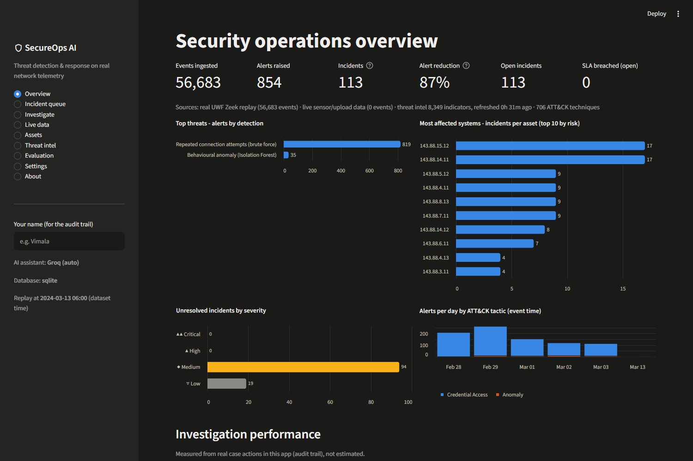
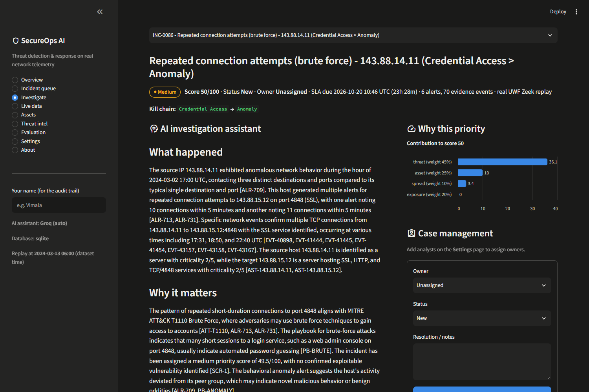
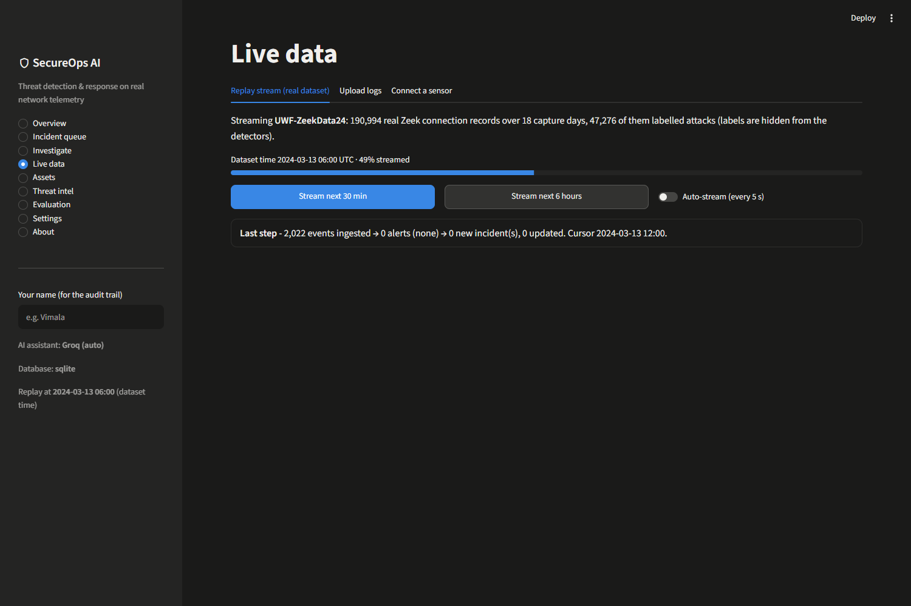

# SecureOps AI — Intelligent Threat Detection and Response

**Live demo:** `https://<your-app>.streamlit.app` · **API docs:** `https://<your-api>.onrender.com/docs`

SecureOps AI is a security operations platform that runs on **real network telemetry** and **live threat intelligence**. It detects threats, **correlates hundreds of alerts into a few incidents**, ranks them by threat × asset importance × live vulnerability exposure, explains each one with an **AI assistant whose every sentence must cite the underlying evidence**, and supports analyst-approved response with a full audit trail.



## Nothing is hard-coded or simulated

| Input | Where it comes from |
|---|---|
| Network events | **Real Zeek logs** from [UWF-ZeekData24](https://datasets.uwf.edu) (MITRE ATT&CK-labelled), streamed live. **Your own Zeek + Suricata sensor** pushing over the API (`sensor/`). Uploaded `conn.log` / `ssh.log` / `eve.json`. |
| Assets | **Discovered from traffic**: hosts, services, fan-in/out, and shared infrastructure. Criticality is inferred, or set by your **inventory CSV**. |
| Vulnerabilities | **NVD API** (CPE → CVE, CVSS), **CISA KEV** (exploited in the wild), **FIRST EPSS** (exploit probability), all fetched live. |
| Threat intel | **abuse.ch Feodo Tracker** (botnet C2), **abuse.ch URLhaus**, **Spamhaus DROP**, refreshed automatically. |
| ATT&CK knowledge | **MITRE ATT&CK** STIX, downloaded from MITRE's repository (700+ techniques). |
| Thresholds, weights, SLAs, team | `config.yaml` defaults, editable at runtime on the **Settings** page and stored in the database. |
| LLM | Groq free tier, with the model **auto-selected from Groq's live model list**; or local Ollama; or an offline evidence engine. |

| AI investigation with cited evidence | Live replay stream |
|---|---|
|  |  |

## How it works

```
Zeek / Suricata (replay · sensor push · upload)
   → normalise → asset discovery
   → detection: 8 ATT&CK-mapped rules + Isolation Forest (per host-hour, trained unsupervised on the first 48 h)
   → streaming correlation: union-find on shared entities within 120 min; new alerts join or merge open incidents
   → prioritisation: 45% threat · 25% asset criticality · 20% CVE exposure (CVSS × KEV/EPSS) · 10% spread → SLA
   → AI assistant: retrieve alerts, raw events, assets, CVEs, ATT&CK and playbooks → LLM → citation verifier
   → case management: owner · status · SLA · approved response · ticket · audit log (MTTA / MTTR measured)
```

## Measured results on real data

The full 18-day UWF replay runs through the production pipeline. The **test set is the 13 days held out in time** and was never used for any choice. Full report: [reports/EVALUATION.md](reports/EVALUATION.md). Reproduce it with `python -m secureops.evaluate --llm-sample 20`.

| Metric (held-out test) | Result |
|---|---|
| Detection, rules + anomaly (source-IP × hour windows) | Precision **0.97** · Recall **0.33** · F1 0.49 · FPR 0.50% |
| Alert overload | **1,451 alerts → 337 incidents (77% fewer items)**; 307 contain real attacks |
| Prioritisation | Precision@307 = 0.91; real incidents score 39 vs 29 for false positives |
| LLM citation accuracy (`gpt-oss-120b`, 20 incidents) | **327 / 327 sentences (100%)** cite only evidence that exists. An earlier run with a 2,000-token cap scored 97.2%: the verifier caught truncated answers and a malformed citation, which is the point of it. 20 incidents is a small sample. |

**Where it fails (reported, not hidden):**
- Credential access (brute force) is detected well. **Single-session SMB techniques** (Persistence, Privilege Escalation, Defense Evasion) and **exfiltration** look like normal connections in connection metadata, so they are mostly or entirely missed.
- UWF's reconnaissance is a few probes per hour, below standard scan thresholds; only the anomaly model catches part of it.
- UWF recorded benign and attack traffic in different weeks, so they are overlaid day by day (time of day preserved). All hosts sit in one /16, so threat-intel and exfiltration rules are exercised by sensor data and tests rather than by this dataset.
- Triage time was not measured with real analysts. The dashboard measures time-to-acknowledge and time-to-resolve from real case actions.

## Run locally

```bash
pip install -r requirements.txt
streamlit run streamlit_app.py          # dashboard  -> http://localhost:8501 (first start downloads live data, ~1 min)
SECUREOPS_API_TOKEN=change-me uvicorn api.main:app --reload   # API -> http://localhost:8000/docs
pytest -q                               # 24 tests on real Zeek/Suricata samples, no network needed
python -m secureops.evaluate            # metrics -> reports/
```

Full stack with Postgres (and optional Ollama): `docker compose up --build`. Live sensor: see [sensor/](sensor/) and [DEPLOY.md](DEPLOY.md).

## Free deployment

**[DEPLOY.md](DEPLOY.md)** covers three levels, all on free tiers: Streamlit Community Cloud (dashboard), Groq (LLM), Neon (persistent Postgres), Render (API for sensors), plus a Zeek/Suricata sensor on a Raspberry Pi, Linux box or WSL2.

## Project layout

```
secureops/
  sources/      zeek.py, suricata.py (parsers) · uwf.py (dataset download + overlay) · replay.py (stream controller)
  intel/        feeds.py (abuse.ch, Spamhaus) · vulns.py (NVD, KEV, EPSS) · attack.py (MITRE ATT&CK)
  detection/    rules.py (ATT&CK-mapped rules) · anomaly.py (Isolation Forest)
  assets.py     discovery + inventory CSV + CPE→CVE lookup
  correlation.py, scoring.py, assistant.py (RAG + citation verifier), pipeline.py (streaming), evaluate.py
  settings.py   config.yaml + runtime overrides · db.py (SQLite / PostgreSQL)
api/main.py     FastAPI: incidents, case updates, sensor ingest, replay, intel, assets (token-protected writes)
sensor/         Zeek + Suricata + shipper (docker compose), pcap processor
streamlit_app.py  analyst dashboard     config.yaml, rules.yaml   all tunables     playbooks/   response knowledge base
```

**Stack:** Python · Pandas · SQL (SQLite/PostgreSQL) · scikit-learn · FastAPI · Streamlit · Altair · Zeek · Suricata · Groq/Ollama · Docker · GitHub Actions.

**Data credits:** UWF-ZeekData24, University of West Florida (CC BY 4.0). Test fixtures: see [tests/fixtures/NOTICE.md](tests/fixtures/NOTICE.md).
