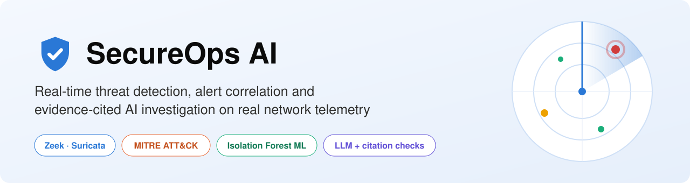
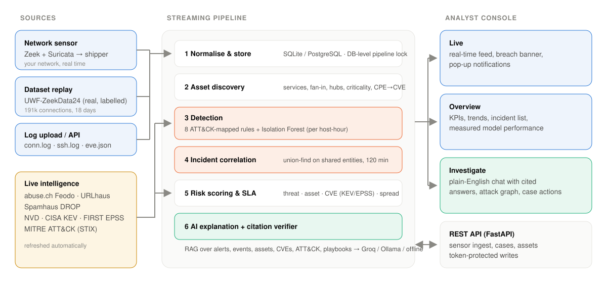

<p align="center">
  
</p>

<p align="center">
  <a href="#live-demo"><b>Live demo</b></a> ·
  <a href="SecureOps_AI_Documentation.pdf"><b>Plain-language guide (PDF)</b></a> ·
  <a href="reports/EVALUATION.md"><b>Evaluation report</b></a> ·
  <a href="DEPLOY.md"><b>Deployment guide</b></a>
</p>

<p align="center">
  
  
  
  
  
  <a href="https://github.com/VM-code27/secureops-ai/actions/workflows/ci.yml"></a>
</p>

---

## Overview

Security teams drown in alerts. **SecureOps AI** is an end-to-end security operations platform that turns raw network telemetry into a short, ranked list of explained incidents:

1. **Ingests real traffic**: a Zeek + Suricata sensor on your network, plus a real MITRE ATT&CK-labelled attack dataset replayed as a live stream.
2. **Detects threats** with eight ATT&CK-mapped rules and an unsupervised Isolation Forest anomaly model.
3. **Correlates** related alerts into incidents, so one attack becomes one case.
4. **Prioritises** each case by threat confidence, asset criticality and live vulnerability exposure (NVD, CISA KEV, FIRST EPSS).
5. **Explains** every case and answers plain-English questions with an LLM whose every sentence must cite the underlying evidence, verified automatically.
6. **Notifies** analysts the moment a serious incident appears, and keeps a human in charge of every response action with a full audit trail.

> **Not a toy:** no simulated data and no hard-coded environment. Events come from real sensors or a real labelled dataset. Assets are discovered from traffic, threat intel and vulnerabilities are fetched live, and every threshold is configuration.

## Live demo

**▶ `https://<your-app>.streamlit.app`** · REST API docs: `https://<your-api>.onrender.com/docs`

| Live threat stream | Ask in plain English, answers cited |
|---|---|
|  |  |

The console has three screens:

| Screen | What it does |
|---|---|
| **Live** | Real-time detection feed for sensor traffic plus the dataset replay. A pop-up notification and a pulsing *Possible breach* banner fire when an incident appears or escalates. |
| **Overview** | KPIs, alerts by ATT&CK tactic, top detections, most-targeted hosts, the incident list, and the model's measured performance. |
| **Investigate** | Chat assistant ("*what is happening on my network?*", "*explain INC-0114*") grounded in the live database, next to an attack graph and case management (owner, status, SLA, approved actions, audit log). |

## Architecture

<p align="center"></p>

| Stage | Implementation |
|---|---|
| Ingest | Zeek (TSV/JSON) and Suricata `eve.json` parsers; sensor shipper; FastAPI ingest endpoints; UWF dataset replay controller |
| Assets | Discovered from traffic (services, fan-in/out, shared-infrastructure hubs, inferred criticality); optional inventory CSV with CPEs → live NVD CVE lookup |
| Detection | Port scan / host sweep, brute force (connection- and SSH-based), success-after-failures, lateral movement, large outbound transfer, live threat-intel match, Suricata signatures; Isolation Forest over per-host-hour behaviour |
| Correlation | Incremental union-find over shared non-hub entities within a configurable gap; new alerts join or merge open incidents |
| Scoring | `45% threat + 25% asset + 20% exposure + 10% spread`; exposure = CVSS weighted by CISA KEV / EPSS; confirmed-exploitable boost; severity → SLA |
| AI | Retrieval over alerts, events, assets, CVEs, MITRE ATT&CK and playbooks → Groq (model auto-selected from Groq's live list), Ollama, or an offline evidence engine → sentence-level citation verifier |
| Storage | SQLite or PostgreSQL; a database-backed pipeline lock serialises concurrent writers (sensors, API workers, dashboard viewers) |

## Results on real labelled data

The full 18-day [UWF-ZeekData24](https://datasets.uwf.edu) replay runs through the production pipeline. The figures below come from the **13 days held out in time**, never used for any tuning decision. Full methodology: [reports/EVALUATION.md](reports/EVALUATION.md).

| Metric (held-out test) | Result |
|---|---|
| Detection precision · recall · false-positive rate *(source IP × hour)* | **0.97** · **0.33** · **0.50%** |
| Alert reduction through correlation | **1,451 alerts → 337 incidents (−77%)** |
| Ranking quality | 91% of the top-307 incidents are real attacks |
| LLM citation accuracy (`gpt-oss-120b`, 20 incidents) | **327 / 327 sentences** cite only evidence that exists |

**Known limitations (reported, not hidden):**
- **Strong on credential attacks, weak on quiet ones.** Single-session SMB activity (persistence, privilege escalation, defense evasion) and exfiltration look like normal connections in connection metadata, so they are largely missed. Detecting them needs payload or endpoint data.
- **Slow reconnaissance** stays below standard scan thresholds; only the anomaly model catches part of it.
- **Recorded in different weeks.** UWF captured benign and attack traffic separately, so they are overlaid day by day with time of day preserved.
- **Triage time** was not measured with analysts. The app records MTTA/MTTR from real case actions.

## Quick start

```bash
git clone https://github.com/VM-code27/secureops-ai.git && cd secureops-ai
pip install -r requirements.txt
streamlit run streamlit_app.py        # http://localhost:8501 - first start pulls live data (~1 min)
```

Optional extras:

```bash
# LLM explanations: free key from https://console.groq.com/keys
echo 'GROQ_API_KEY = "gsk_..."' > .streamlit/secrets.toml

# REST API (sensor ingest, case updates)
SECUREOPS_API_TOKEN=change-me uvicorn api.main:app --reload     # http://localhost:8000/docs

# Live network sensor (Linux / Raspberry Pi / WSL2 / Docker Desktop)
cd sensor && cp .env.example .env && docker compose up -d

# Full stack with PostgreSQL (+ optional Ollama)
docker compose up --build
```

## Deployment (free tiers)

| Component | Service |
|---|---|
| Dashboard | Streamlit Community Cloud |
| LLM | Groq |
| Persistent database | Neon PostgreSQL |
| Sensor ingest API | Render |
| Sensor | Raspberry Pi or any Linux host with Docker |

Step-by-step instructions are in **[DEPLOY.md](DEPLOY.md)**.

## Configuration

| File / setting | Purpose |
|---|---|
| [`config.yaml`](config.yaml) | Detection thresholds, home networks, correlation gap, scoring weights, severity bands, SLAs, feed URLs, replay pace, AI provider |
| [`rules.yaml`](rules.yaml) | Rule catalogue: names, ATT&CK tactic and technique, confidence, playbook |
| Settings (in app) | Analyst team, allow-listed sources, your name for the audit trail |
| Secrets | `GROQ_API_KEY`, `DATABASE_URL`, `SECUREOPS_API_TOKEN`, `NVD_API_KEY` (all optional) |

## Testing and evaluation

```bash
pytest -q                                          # 21 tests on real Zeek/Suricata samples, no network needed
python -m secureops.evaluate --llm-sample 20       # reproduce reports/ (LLM sample needs GROQ_API_KEY)
python docs/build_documentation.py                 # rebuild the PDF guide from the latest results
```

CI (GitHub Actions) runs lint, the test suite, the full evaluation, a Docker build and a sensor-kit config check on every push.

## Project structure

```
secureops/
├── sources/      zeek.py · suricata.py · uwf.py (dataset + overlay) · replay.py (stream controller)
├── intel/        feeds.py (abuse.ch, Spamhaus) · vulns.py (NVD, KEV, EPSS) · attack.py (MITRE ATT&CK)
├── detection/    rules.py · anomaly.py (Isolation Forest)
├── assets.py     discovery, inventory, CPE→CVE
├── correlation.py · scoring.py · pipeline.py · db.py · settings.py
├── assistant.py  RAG + citation verifier      chat.py   conversational investigation
└── evaluate.py   held-out evaluation
api/main.py         FastAPI service             streamlit_app.py   analyst console
sensor/             Zeek + Suricata + shipper    playbooks/         response knowledge base
reports/            measured results             docs/              images and PDF builder
```

## Security and privacy

- **Human in the loop.** Response actions are recorded for approval and never executed automatically. Every case change is audited.
- **Secrets stay out of code.** Keys live in git-ignored `.streamlit/secrets.toml` or the host's secret store. API writes require `SECUREOPS_API_TOKEN`.
- **LLM data flow.** With a Groq key, the evidence for a question is sent to Groq. Without one, nothing leaves the system.
- **Monitor only networks you own** or are authorised to monitor.

## Acknowledgements

UWF-ZeekData24 - University of West Florida (CC BY 4.0) · abuse.ch Feodo Tracker and URLhaus · Spamhaus DROP · NIST NVD · CISA KEV · FIRST EPSS · MITRE ATT&CK · Zeek · Suricata with ET Open rules. Test-fixture licences: [tests/fixtures/NOTICE.md](tests/fixtures/NOTICE.md).

## Author

**Vimala Mehrotra** - built as a portfolio project in security analytics, applied machine learning and AI-assisted investigation.
